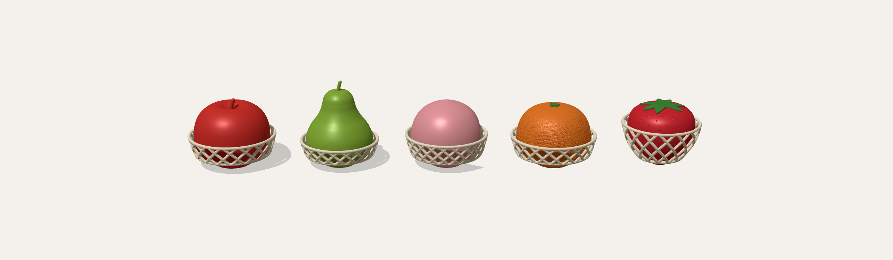
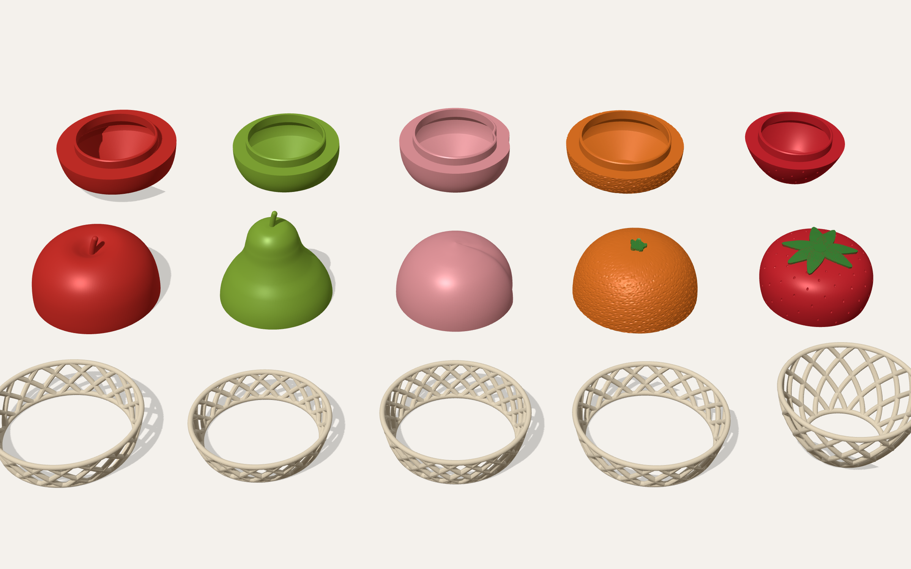

# 水果收纳盒 · 3D 打印模型

五款可开合的水果造型小盒（苹果、梨、桃、橘子、草莓），每款都配一个**可单独打印的网兜**。




## 文件（`stl/`，单位 mm）

| 水果 | 底座 `_base` | 盖子 `_lid` | 网兜 `_net` | 其它 |
|---|---|---|---|---|
| 苹果 apple | Ø77 × 32 | Ø78 × 44（含果柄） | Ø90 × 22 | |
| 梨 pear | Ø69 × 32 | Ø69 × 63（含果柄） | Ø81 × 18 | |
| 桃 peach | Ø72 × 35 | Ø72 × 40（带桃缝） | Ø85 × 23 | |
| 橘子 orange | Ø76 × 32 | Ø76 × 39（带果皮纹理） | Ø89 × 21 | `orange_calyx` 果蒂 |
| 草莓 strawberry | Ø64 × 35 | Ø69 × 35（带籽坑和叶子） | Ø81 × 39 | `strawberry_calyx` 叶子 |

* 盖子通过底座上的一圈内唇口定位，单边间隙 0.2 mm，盖上去是轻推即合的松配合。
* `_calyx` 文件已经放在和盖子相同的坐标位置，用于多色打印（在切片软件里把它作为同一对象的“零件/修改器”导入，换绿色材料），也可以只当上色参考。单色打印时忽略即可，盖子本身已经包含叶子。

## 打印方式（全部无需支撑）

* **底座**：开口朝上直接放。底部做了一圈平底，外壁悬垂不超过约 58°。
* **盖子**：开口朝下（文件已摆好）。内腔顶部做成锥形，所以内部不会有悬空的“天花板”。
* **网兜**：底圈朝下直接放。网条倾角约 45°，交叉点互相支撑。
  推荐 **TPU 95A**（软，像真的泡沫网），PLA 也能打，只是硬一些。
* 推荐参数：0.2 mm 层高、3 圈墙、15% 填充，0.4 mm 喷嘴。
* 壁厚 1.6 mm；如果你的打印机偏紧，可以把 `generate.py` 里的 `CLEAR` 调到 0.25–0.3 后重新生成。

## 使用

网兜套在水果下半部，水果自身平底着桌，网兜像一圈“领子”卡在下腹部。网口直径大于水果最宽处，可以直接取出。

## 修改与重新生成

所有模型由 `generate.py` 参数化生成：

```bash
pip install manifold3d numpy
python3 generate.py            # 输出到 ./stl
```

可调整的主要参数在文件开头：壁厚 `WALL`、配合间隙 `CLEAR`、唇口高度 `LIP_H`、网条粗细 `NET_RS`、网兜外扩 `NET_FLARE` 等；每种水果的外形是 `FRUITS` 里的一串 (半径, 高度) 控制点，改这些点就能改外形，开合线高度是 `zs`。

外形是按照常见水果的形态自行建模的，不包含原商品的标签贴或商标。
