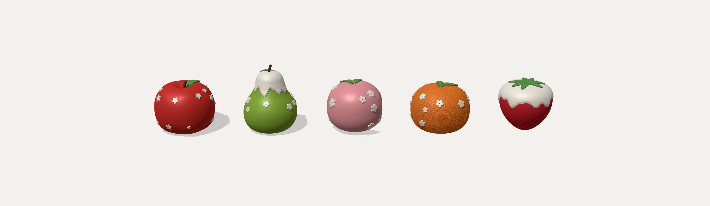
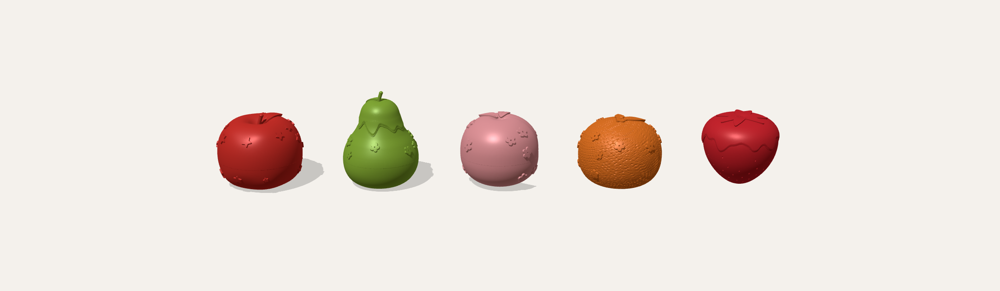
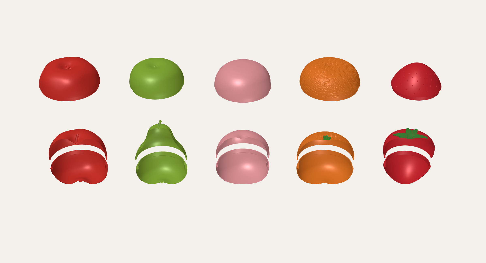

# 水果收纳盒 · 3D 打印模型

五款可开合的水果造型小盒（苹果、梨、桃、橘子、草莓），每款都配一个**可单独打印的网兜**。







## 原版文件（`stl/plain/`，单位 mm）

| 水果 | 底座 `_base` | 盖子 `_lid` | 网兜 `_net` | 其它 |
|---|---|---|---|---|
| 苹果 apple | Ø77 × 32（底部花萼窝 + 五角萼片、五棱） | Ø77 × 41（深果柄窝 + 果柄） | Ø90 × 29 | |
| 梨 pear | Ø69 × 32（底部小花萼） | Ø69 × 62（果柄，略歪） | Ø82 × 24 | |
| 桃 peach | Ø72 × 35 | Ø72 × 34（果柄窝 + 桃缝） | Ø85 × 26 | |
| 橘子 orange | Ø77 × 32（底部脐窝） | Ø77 × 36（全身果皮毛孔） | Ø89 × 26 | `orange_calyx` 果蒂 |
| 草莓 strawberry | Ø64 × 35 | Ø68 × 35（籽坑和叶子） | Ø81 × 38 | `strawberry_calyx` 叶子 |

外形按真实水果做：底部不是平底，也没有为打印做的锥形，苹果底部是一个带五角萼片的浅窝，靠窝外一圈立在桌上，和真苹果一样。
内部和铁盒一样是**均匀薄壳**（壁厚 1.6 mm），里面顺着外形是圆的；只在开口处向内收一点，形成盖子套上去的唇口。

* 盖子通过底座上的一圈内唇口定位，单边间隙 0.2 mm，盖上去是轻推即合的松配合。
* `_calyx` 文件已经放在和盖子相同的坐标位置，用于多色打印（在切片软件里把它作为同一对象的“零件/修改器”导入，换绿色材料），也可以只当上色参考。单色打印时忽略即可，盖子本身已经包含叶子。

## 装饰版（`stl/decorated/`）

在原版盒子上加了凸起约 1.2 mm 的装饰，贴着果皮走：

| 水果 | 装饰 |
|---|---|
| 苹果 | 白色星星（盖子和底座都有）、果柄上一片绿叶、棕色果柄 |
| 梨 | 顶部白色奶油淋面（带滴落）、身上小白花、绿叶、棕色果柄 |
| 桃 | 一圈小白花（避开桃缝）、顶上两片绿叶 |
| 橘子 | 小白花、果蒂旁两片绿叶 |
| 草莓 | 顶部白色奶油淋面，绿色叶子压在奶油上面 |

**单色打印**：直接用 `stl/decorated/<水果>_lid.stl`、`<水果>_base.stl`。装饰会变成浮雕，换个丝绸或哑光耗材就很好看。

**多色打印**（拓竹 AMS / Prusa MMU 等）：`stl/decorated/multicolor/<水果>/` 下每个颜色一个文件，坐标已经对齐、互不重叠：

* `lid_body` 果身色 · `lid_white` 白色（奶油/星星/小花） · `lid_green` 绿色（叶子/果蒂） · `lid_brown` 棕色（果柄）
* `base_body`、`base_white`、`base_brown` 同理

导入方法（Bambu Studio / OrcaSlicer）：把同一个零件的几个文件**一次全选拖进去**，弹出“是否作为一个多部件对象加载”时选**是**，然后在左侧零件列表里给每个零件选耗材。盖子和底座分别各导入一次。

> 网兜不变，用 `stl/plain/<水果>_net.stl`。
> 装饰的位置、数量、大小都在 `decor.py` 的 `design()` 里，改完运行 `python3 decor.py` 重新生成。

## 打印方式

底座和盖子为了保持真实外形和均匀薄壳，**需要支撑**；网兜不需要。

* **底座**：开口朝上。打开 **树状支撑（tree）+ 仅从打印板生成**，支撑只在外底，不会长进盒子里。
* **盖子**：开口朝下（文件已摆好）。同样用树状支撑、仅从打印板生成，支撑从开口伸进去托住内顶，打完从开口取出。
* **网兜**：底圈朝下直接放，不用支撑。推荐 **TPU 95A**（软，像真的泡沫网），PLA 也能打，只是硬一些。
* 推荐参数：0.12–0.16 mm 层高（曲面更细腻）、3 圈墙（1.6 mm 壁基本是纯墙）、0.4 mm 喷嘴；支撑 Z 距离 0.2 mm 便于剥离。
* 草莓底部是钝尖，单独放会晃，放进网兜里摆放；打印底座时建议加 brim。
* 如果你的打印机偏紧，把 `generate.py` 里的 `CLEAR` 调到 0.25–0.3 后重新生成。
* 树脂（光固化）打印也很合适，薄壳表面更光滑。

## 使用

网兜套在水果下半部，水果靠自己的底部立在桌上，网兜像一圈“领子”卡在下腹部。网口直径大于水果最宽处，可以直接取出。

## 修改与重新生成

所有模型由 `generate.py` 参数化生成：

```bash
pip install manifold3d numpy
python3 generate.py            # 原版，输出到 ./stl/plain
python3 decor.py               # 装饰版，输出到 ./stl/decorated
```

可调整的主要参数在文件开头：壁厚 `WALL`、配合间隙 `CLEAR`、唇口高度 `LIP_H`、网条粗细 `NET_RS`、网兜外扩 `NET_FLARE` 等；每种水果的外形是 `FRUITS` 里的一串 (半径, 高度) 控制点，改这些点就能改外形，开合线高度是 `zs`。

外形是按照常见水果的形态自行建模的，不包含原商品的标签贴或商标。
